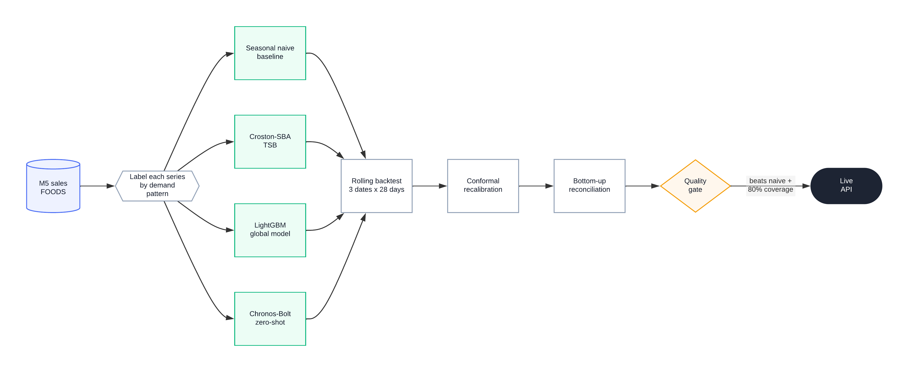
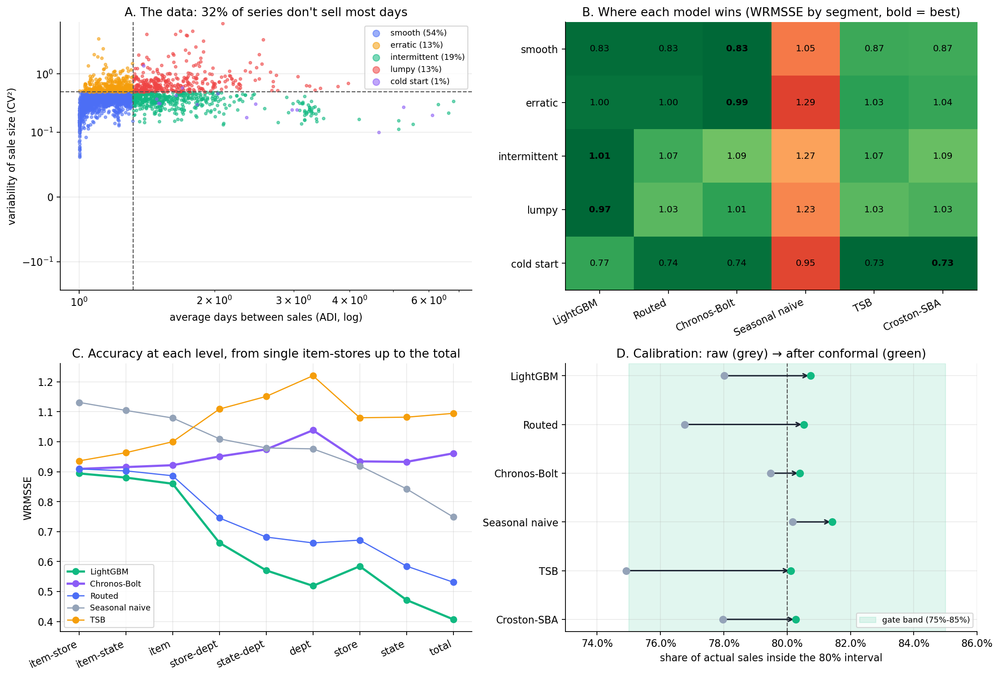

# ForecastBench

A demand-forecasting benchmark on the M5 Walmart data, with a small API that serves the forecasts.

**Live demo:** [forecastbench-436839971921.northamerica-northeast1.run.app](https://forecastbench-436839971921.northamerica-northeast1.run.app)

The idea is simple. Every model goes through the same test: same series, same backtest windows, same metrics. A model only gets promoted if it beats a seasonal naive forecast and its 80% prediction intervals actually cover about 80% of what happens.

## Results

Three forecast dates, 28 days ahead each, about 2,530 item-store series. Lower is better for the error metrics. Coverage is the share of actual sales inside the 80% interval, before and after recalibration (target 80%). Runtime is seconds per 1,000 series.

| Model | WRMSSE | MASE | Pinball | Raw cov. | Calib. cov. | Runtime | Gate |
|---|---|---|---|---|---|---|---|
| LightGBM | **0.650** | 1.020 | **0.323** | 78.0% | 80.7% | 21.3 | promoted |
| Routed | 0.731 | 1.027 | 0.332 | 76.8% | 80.5% | 14.2 | promoted |
| Chronos-Bolt | 0.949 | **1.008** | 0.328 | 79.5% | 80.4% | 3.5 | promoted |
| Seasonal naive | 0.977 | 1.248 | 0.402 | 80.2% | 81.4% | 0.04 | baseline |
| TSB | 1.071 | 1.040 | 0.339 | 74.9% | 80.1% | 0.05 | no |
| Croston-SBA | 1.075 | 1.086 | 0.346 | 78.0% | 80.3% | 0.05 | no |

*ForecastBench at a glance: (A) demand patterns in the data, (B) best model per segment, (C) accuracy at each level of the hierarchy, (D) interval coverage before and after conformal recalibration.*

What I took from it:

- LightGBM wins clearly, 33% better than seasonal naive on WRMSSE. It's also the best on intermittent and lumpy items, which I didn't expect.
- Chronos-Bolt was never trained on M5 and still passes the gate, at a sixth of LightGBM's runtime. It's the best on smooth and erratic series but falls behind once forecasts are summed up the hierarchy.
- Routing each series to a "specialist" model didn't pay off. TSB on intermittent and lumpy items loses to LightGBM. The one route that works is new items to Chronos (0.739 vs 0.768).
- After conformal recalibration every model lands between 80% and 81.4% coverage, so the gate ends up deciding on accuracy alone.
- New items are rare in M5 FOODS (about 21 per forecast date), so take that slice as a rough signal.

Per-level and per-segment numbers are in `artifacts/`.

## How it works

- **Data.** The FOODS category: the 2,500 best-selling item-stores, plus items that are new at each forecast date.
- **Segments.** Each series is labelled smooth, erratic, intermittent or lumpy (Syntetos-Boylan), or new if it has under 120 days of sales.
- **Models.** Seasonal naive, Croston-SBA, TSB, one global LightGBM (Tweedie mean plus 10/50/90% quantiles), Chronos-Bolt small used zero-shot, and a routed setup: new items go to Chronos, intermittent and lumpy to TSB, the rest to LightGBM. The routing rule was fixed before seeing any results.
- **Intervals.** Recalibrated with conformal prediction on the 28 days just before each forecast date, never on the test window.
- **Hierarchy.** Item-store forecasts are summed bottom-up so stores, states and the total add up. WRMSSE is averaged over 9 levels. The weights are recomputed for this subset, so the scores aren't comparable to the Kaggle leaderboard.

Everything that defines the benchmark is in `configs/benchmark.yaml`.

## The math

**Demand segments.** For each series, over the last 365 days since its first sale:

$$\text{ADI} = \frac{n}{n_{+}}, \qquad \text{CV}^2 = \left(\frac{\sigma_{+}}{\mu_{+}}\right)^2$$

where $n$ is the number of days, $n_{+}$ the number of days with a sale, and $\mu_{+}, \sigma_{+}$ the mean and standard deviation of the non-zero sales. The cutoffs are ADI = 1.32 and CV² = 0.49. A series with fewer than 120 days since its first sale counts as new.

**TSB.** It tracks the chance of a sale $p_t$ and the typical sale size $z_t$ separately, with $\alpha = \beta = 0.1$:

$$p_t = p_{t-1} + \beta\left(\mathbb{1}[y_t > 0] - p_{t-1}\right), \qquad z_t = z_{t-1} + \alpha (y_t - z_{t-1}) \ \text{ when } y_t > 0, \qquad \hat y = p_T  z_T$$

**Point accuracy (WRMSSE).** For a series with history $y_1, \dots, y_T$ (from its first sale) and an $h = 28$ day forecast:

$$\text{RMSSE}_i = \sqrt{\frac{\frac{1}{h}\sum_{k=1}^{h}\left(y_{T+k} - \hat y_{T+k}\right)^2}{\frac{1}{T-1}\sum_{t=2}^{T}\left(y_t - y_{t-1}\right)^2}}, \qquad \text{WRMSSE} = \frac{1}{L}\sum_{\ell=1}^{L}\ \sum_{i \in \ell} w_i \text{RMSSE}_i$$

with $L = 9$ hierarchy levels and $w_i$ the series' share of its level's dollar sales over the last 28 days. MASE is the same idea with absolute errors.

**Quantile accuracy (scaled pinball).** For $q \in \lbrace 0.1, 0.5, 0.9 \rbrace$ and the scale $s_i = \frac{1}{T-1}\sum_{t=2}^{T}|y_t - y_{t-1}|$:

$$\rho_q(u) = \max\left(q u,\ (q-1) u\right), \qquad \text{Pinball}_i = \frac{1}{s_i} \cdot \frac{1}{3h}\sum_{q}\sum_{k=1}^{h}\rho_q\left(y_{T+k} - \hat q_{T+k}\right)$$

**Conformal recalibration.** On the 28 days just before the forecast date, every raw interval $[\ell, u]$ gets a score for how far the truth fell outside it:

$$E = \frac{\max\left(\ell - y,\ y - u\right)}{s_i}$$

Pooling the $n$ scores within a segment, $\hat Q$ is the $\lceil (n+1)(1-\alpha) \rceil$-th smallest one, with $\alpha = 0.2$. The recalibrated interval is

$$\left[\ \max\left(0,\ \ell - \hat Q  s_i\right),\ \ u + \hat Q  s_i\ \right]$$

which covers about 80% of new data as long as the calibration window behaves like the test window.

**Hierarchy.** With $S_\ell$ the 0/1 matrix that sums item-stores into level $\ell$, each level's forecast is the sum of its item-store forecasts:

$$\hat{\mathbf y}_\ell = S_\ell \ \hat{\mathbf y}_{\text{item-store}}$$

so stores, states and the total always add up. Each level gets its own interval width from the scores $\lvert y - \hat y \rvert / s$.

**Quality gate.**

$$\text{promoted} \iff \text{WRMSSE}_m < \text{WRMSSE}_{\text{naive}} \ \ \text{and}\ \ 0.75 \le \text{coverage}_m \le 0.85$$

## Run it

Download the data from [Kaggle](https://www.kaggle.com/competitions/m5-forecasting-accuracy/data) and put `sales_train_evaluation.csv`, `calendar.csv` and `sell_prices.csv` in `data/raw/`.

~~~bash
pip install -r requirements.txt
python -m forecastbench.benchmark
~~~

The leaderboard ends up in `artifacts/leaderboard.csv`. Each forecast date can also run on its own with `--task 0` to `--task 3`, then `--aggregate`.

## API

The API serves precomputed forecasts, so nothing is trained or run per request.

~~~bash
uvicorn app.main:app --port 8080
gcloud run deploy forecastbench --source . \
  --region northamerica-northeast1 --allow-unauthenticated
~~~

- `/` results and a forecast explorer
- `/api/forecast/{id}` 28-day forecast with its interval, the model that served it, why it was routed there, and the main drivers when LightGBM served it
- `/api/series`, `/api/benchmark`, `/health`
